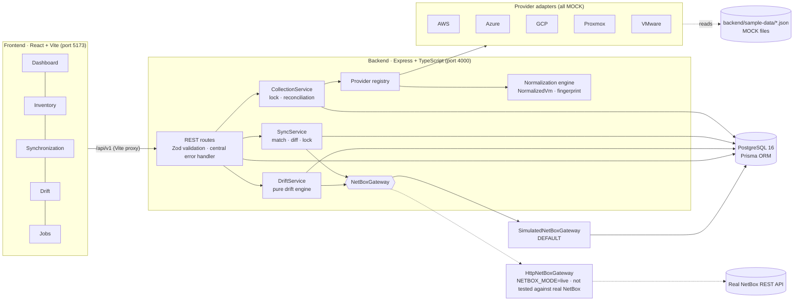

# CloudVM – Multi-Cloud VM Inventory Management Platform

CloudVM collects virtual machine inventory from **AWS, Microsoft Azure, Google Cloud, Proxmox and VMware**, normalizes the provider-specific records into one common model, stores it in PostgreSQL, synchronizes it with **NetBox** (the intended single source of truth) and reports drift between the two.

Built as a working prototype for a technical evaluation (deadline 31 Oct 2026).

> ### ⚠️ Read this first – what is real and what is simulated
> | Area | Status in this prototype |
> |---|---|
> | Provider collection (AWS, Azure, GCP, Proxmox, VMware) | **MOCK.** Each adapter reads a provider-shaped sample file from `backend/sample-data/` (every file is marked `_meta.mock: true`). **No cloud or hypervisor API is called.** The adapter interface is designed so a real SDK client can replace the file reader. |
> | NetBox synchronization | **SIMULATION** (`NETBOX_MODE=simulation`, the default). Writes go to a local PostgreSQL table (`simulated_netbox_vms`) that follows NetBox's rules (unique name per cluster, `serial`, status values). **No real NetBox instance has been contacted or tested.** |
> | Live NetBox client (`HttpNetBoxGateway`) | Implemented against NetBox's documented REST endpoints and contract-tested against a **local fake HTTP server only**. Not verified against a real NetBox. |
> | Scheduler (milestone M6) | **Not implemented.** Collection and sync run only when triggered manually (UI buttons or `POST` endpoints). `SCHEDULER_ENABLED` / `COLLECTION_CRON` exist in `.env.example` but nothing reads them yet. |
> | Docker images for backend/frontend | **Not provided.** Docker Compose runs PostgreSQL only; backend and frontend run with `npm run dev`. |
>
> The UI labels this everywhere: a **MOCK PROVIDER DATA** badge, a **NETBOX SIMULATION** badge, a SIMULATION banner on the Sync and Drift screens, and a **NOT IMPLEMENTED** scheduler card on the Jobs screen.

---

## Contents
1. [Features](#features)
2. [Architecture](#architecture)
3. [Technology stack](#technology-stack)
4. [Repository layout](#repository-layout)
5. [Local setup](#local-setup)
6. [Running the application](#running-the-application)
7. [Testing and verification](#testing-and-verification)
8. [Configuration](#configuration)
9. [Limitations and future work](#limitations-and-future-work)
10. [Further documentation](#further-documentation)

---

## Features

| # | Feature | Implemented as |
|---|---|---|
| 1 | Enterprise dashboard | Total / running / stopped / decommissioned VMs, VMs-by-provider chart, capacity (vCPU, RAM, disk), latest collection, latest sync, latest drift report |
| 2 | VM inventory | Server-side search (name, hostname, IP, IDs, OS, owner), provider / power / lifecycle filters, sorting, pagination, VM detail drawer with raw MOCK payload and NetBox sync state |
| 3 | Five provider adapters | `ProviderAdapter` interface + one MOCK adapter and one pure mapper per provider |
| 4 | Normalization engine | Common `NormalizedVm` model validated with Zod; binary units (memory MiB, disk GiB); scoped identity; missing / inconsistent fields handled; invalid records rejected individually |
| 5 | Idempotent persistence | Deterministic SHA-256 fingerprint; create / update / unchanged (heartbeat only) / account-scoped decommission |
| 6 | NetBox synchronization | CREATE / UPDATE / DECOMMISSION / SKIP; duplicate detection; per-VM sync state; sync history and events; SIMULATION gateway + live REST gateway |
| 7 | Drift & orphan reporting | Missing in NetBox, orphan in NetBox, resource mismatch, power-state mismatch, duplicates; severity levels; remediation = mark for re-sync (never deletes) |
| 8 | Collection & sync history | Collection runs with per-provider results and errors; sync runs with per-VM events. Scheduled collection: **not implemented** |

---

## Architecture

A **modular monolith**: one Express process, one PostgreSQL database, clear module boundaries and constructor-based dependency injection wired in a single composition root (`backend/src/container.ts`).



### Data flow
1. **Collect** – `POST /collections` → each adapter returns a `CollectionBatch` (records, rejected records, and the accounts it queried with `COMPLETE`/`FAILED` status).
2. **Normalize** – a pure mapper per provider turns raw records into `NormalizedVm` objects (Zod-validated) with a scoped `externalId` and a fingerprint.
3. **Persist & reconcile** – one transaction per provider: create, update, heartbeat unchanged rows, and decommission VMs that disappeared from an account that was queried **completely**. Failed accounts/providers are never reconciled.
4. **Sync** – `POST /sync` → VMs whose fingerprint is unchanged since their last sync are skipped with zero gateway calls; the others are matched (stored ID → serial → name) and created / updated / decommissioned in the NetBox target.
5. **Drift** – `POST /drift/reports` reads all target records (`NetBoxReader.listVms()`) and compares them with the local inventory.

Detailed design: [`docs/ARCHITECTURE_PLAN.md`](docs/ARCHITECTURE_PLAN.md), [`docs/NORMALIZATION.md`](docs/NORMALIZATION.md), [`docs/SYNC_DESIGN.md`](docs/SYNC_DESIGN.md), [`docs/DATABASE.md`](docs/DATABASE.md).

---

## Technology stack

| Layer | Technology |
|---|---|
| Frontend | React 19, TypeScript (strict), Vite, Tailwind CSS 4, React Router 7, Recharts, Axios |
| Backend | Node.js ≥ 20, Express 5, TypeScript (strict), Zod, Pino (structured JSON logs), Helmet, CORS |
| Database | PostgreSQL 16 (Docker), Prisma ORM 6.19 (+ two SQL CHECK constraints in the init migration) |
| Integration | NetBox REST API (`/api/virtualization/virtual-machines/`, clusters, cluster types, tags, `/api/status/`) – SIMULATION by default |
| Testing | Vitest, Supertest (backend), Testing Library + jsdom (frontend) |
| Infrastructure | Docker Compose (PostgreSQL) |
| Scheduling | node-cron planned for M6 – **not implemented** |

---

## Repository layout

```
CloudVM/
├── docker-compose.yml          PostgreSQL 16 (bound to 127.0.0.1)
├── .env.example                Postgres credentials/port for Docker Compose
├── backend/
│   ├── prisma/                 schema.prisma, migrations/, sql/ (CHECK constraints)
│   ├── sample-data/            5 MOCK provider files (60 entries)
│   ├── src/
│   │   ├── config/             Zod-validated environment
│   │   ├── domain/             identity, lifecycle/power rules, NormalizedVm
│   │   ├── lib/                logger, prisma client, errors, db checker
│   │   ├── middleware/         request logger, error handler
│   │   ├── modules/
│   │   │   ├── providers/      ProviderAdapter, mock adapters, raw schemas, registry
│   │   │   ├── normalization/  mappers, normalizer, fingerprint
│   │   │   ├── collection/     CollectionService, reconciliation, routes
│   │   │   ├── inventory/      /vms query + routes
│   │   │   ├── dashboard/      /dashboard/summary
│   │   │   ├── netbox/         NetBoxGateway, simulated + HTTP gateways, mapping, retry
│   │   │   ├── sync/           SyncService, plan, routes
│   │   │   └── drift/          drift engine, service, routes
│   │   ├── app.ts              Express app factory (no listen → testable)
│   │   ├── container.ts        composition root (dependency injection)
│   │   └── index.ts            entry point, graceful shutdown
│   └── tests/                  unit/ and integration/ (separate cloudvm_test DB)
├── frontend/
│   ├── src/                    api/, hooks/, lib/, components/, pages/
│   └── tests/                  page + helper tests (API mocked)
├── scripts/                    verify-m0.sh … verify-m5.sh (end-to-end checks)
└── docs/                       design docs, API, demo, interview notes, checklist
```

---

## Local setup

### Prerequisites
- Node.js **20+** and npm
- Docker Desktop (for PostgreSQL)
- macOS or Linux shell (the verify scripts are bash)

### 1. Environment files
```bash
cd CloudVM
cp .env.example .env                       # Docker Compose: POSTGRES_USER/PASSWORD/DB/PORT
cp backend/.env.example backend/.env       # backend: DATABASE_URL, NETBOX_MODE, ...
```
If port 5432 is already in use, set `POSTGRES_PORT=5433` in `.env` **and** use the same port in `DATABASE_URL` in `backend/.env` (the development Mac used 5433). Never commit either `.env` file – both are git-ignored.

### 2. Start PostgreSQL
```bash
docker compose up -d postgres
docker compose ps            # wait for "healthy"
```

### 3. Backend dependencies and database migration
```bash
cd backend
npm install                  # also runs `prisma generate`
npx prisma migrate deploy    # applies migration 20261030132142_init (9 tables + CHECK constraints)
npm run db:check             # → PostgreSQL reachable
```
For schema development use `npm run db:migrate` (`prisma migrate dev`). `npm run db:studio` opens Prisma Studio to browse the data.

### 4. Frontend dependencies
```bash
cd ../frontend
npm install
```

---

## Running the application

Two terminals:

```bash
# Terminal 1 – API on http://localhost:4000/api/v1
cd backend && npm run dev

# Terminal 2 – UI on http://localhost:5173 (proxies /api to port 4000)
cd frontend && npm run dev
```

Open **http://localhost:5173**. The database starts empty:
1. **Dashboard → Run collection** loads the MOCK inventory (58 VMs from 60 sample entries; 2 Proxmox entries – a template and an LXC container – are intentionally skipped).
2. **Synchronization → Run sync** writes them to the simulated NetBox.
3. **Drift → Generate report** compares the two.

Quick API check:
```bash
curl -s http://localhost:4000/api/v1/health
```

Production builds: `cd backend && npm run build && npm start`; `cd frontend && npm run build` (static files in `frontend/dist/`).

A five-minute walkthrough is in [`docs/DEMO.md`](docs/DEMO.md).

---

## Testing and verification

```bash
cd backend && npm test        # unit + integration tests (integration tests need PostgreSQL and the cloudvm_test DB)
cd frontend && npm test       # 25 component/helper tests, API mocked
```

Integration tests use a **separate database** (`cloudvm_test`, derived from `DATABASE_URL`) and refuse to truncate any database whose name does not end in `_test`. The verify scripts create and migrate it:

```bash
bash scripts/verify-m5.sh     # typecheck, build, full backend suite, live API demo; writes m5-verification.log
```

Each `scripts/verify-mN.sh` re-runs the checks for milestone N and writes `mN-verification.log`. Results recorded on the development Mac (see [`docs/CHECKLIST.md`](docs/CHECKLIST.md)):

| Milestone | Verified result |
|---|---|
| M3 persistence & inventory API | 205/205 tests; second collection = 58 unchanged; concurrent start = one 202, one 409 |
| M4 NetBox sync (SIMULATION) | 257/257 tests; second sync = 0 created / 0 updated / 58 skipped |
| M5 drift | verify-m5 PASS; drift demo 0 → 5 findings (one of each type) → 0 after remediation + sync |
| M7–M8 UI | Visual check passed: real stats, 58 VMs, MOCK/SIMULATION labels |
| M9 UI | 25/25 frontend tests and production build pass in the development workspace; Mac visual check in progress |

---

## Configuration

`backend/.env` (validated with Zod at startup – the process refuses to start on invalid values):

| Variable | Default | Purpose |
|---|---|---|
| `NODE_ENV` | `development` | `development` / `test` / `production` |
| `PORT` | `4000` | API port |
| `LOG_LEVEL` | `info` | Pino log level |
| `CORS_ORIGIN` | `http://localhost:5173` | Comma-separated allowed origins |
| `DATABASE_URL` | – | PostgreSQL connection string |
| `NETBOX_MODE` | `simulation` | `simulation` (local stand-in) or `live` |
| `NETBOX_URL`, `NETBOX_TOKEN` | empty | Required when `NETBOX_MODE=live` – startup validation fails without them |
| `NETBOX_AUTH_SCHEME` | `Token` | `Token` (v1 tokens) or `Bearer` (NetBox ≥ 4.5 v2 tokens) |
| `SCHEDULER_ENABLED`, `COLLECTION_CRON` | `false`, `*/15 * * * *` | Reserved for M6 – **not used yet** |

No credentials are hard-coded; real cloud credentials are not needed (and not used) because all adapters are MOCK.

---

## Limitations and future work

**Limitations (honest list)**
- All provider data is MOCK sample data; no AWS/Azure/GCP/Proxmox/VMware API is called.
- NetBox sync and drift run against the SIMULATION table; the live HTTP gateway has never been run against a real NetBox.
- No scheduler (M6) – manual triggers only.
- No authentication/authorization on the API or UI (local prototype).
- Proxmox LXC containers and templates are skipped by design.
- Orphan and duplicate NetBox records are reported only – never deleted or merged automatically (intentional safety choice).
- Single backend instance assumed: an in-process lock plus a database guard on RUNNING rows prevents concurrent runs; multi-instance deployments would need a PostgreSQL advisory lock.
- Frontend bundle is a single ~700 kB chunk (Recharts); code splitting not done.

**Next steps**
1. M6 scheduler: node-cron job calling `CollectionService.start('SCHEDULED')` then sync, with next-run time in the Jobs screen.
2. Real adapters one at a time (AWS `DescribeInstances` with the AWS SDK v3 first), keeping the mappers and their tests.
3. Run the HTTP gateway against a disposable NetBox (`netbox-docker`) and add it to Compose.
4. Dockerfiles for backend and frontend; CI pipeline running both test suites.
5. Authentication (OIDC) and role-based access for sync/remediation actions.

---

## Further documentation

| Document | Contents |
|---|---|
| [`docs/API.md`](docs/API.md) | Every implemented endpoint with parameters, examples and errors |
| [`docs/DEMO.md`](docs/DEMO.md) | Five-minute technical demo script |
| [`docs/INTERVIEW_NOTES.md`](docs/INTERVIEW_NOTES.md) | Design decisions, trade-offs, likely questions |
| [`docs/ARCHITECTURE_PLAN.md`](docs/ARCHITECTURE_PLAN.md) | Original architecture proposal and milestones |
| [`docs/DATABASE.md`](docs/DATABASE.md) | Prisma schema, ER diagram, constraints |
| [`docs/NORMALIZATION.md`](docs/NORMALIZATION.md) | Provider field mapping, units, identity |
| [`docs/SYNC_DESIGN.md`](docs/SYNC_DESIGN.md) | NetBox sync and drift design |
| [`docs/CHECKLIST.md`](docs/CHECKLIST.md) | Completed / pending / blocked tasks |
| [`docs/DEVELOPMENT_NOTES.md`](docs/DEVELOPMENT_NOTES.md) | Milestone log and run instructions |
