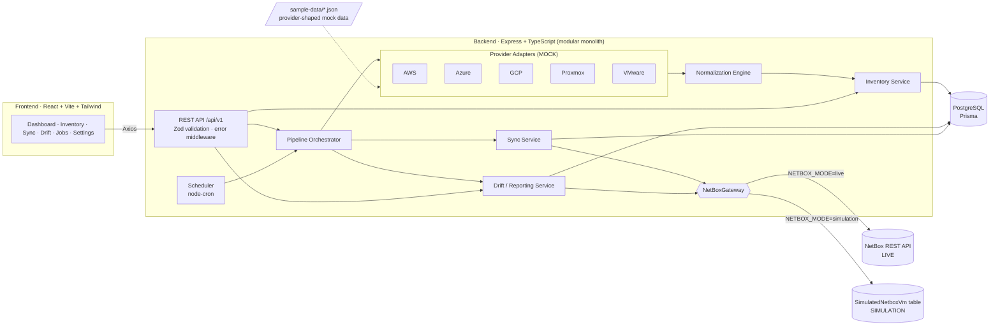

# CloudVM – Architecture & Implementation Plan

> Status: **PROPOSAL – awaiting approval** · Prepared 30 Oct 2026 · Deadline 31 Oct 2026, 16:00 IST

---

## 1. Requirements analysis (what actually matters for the evaluation)

The evaluator will judge four things: (1) does the **pipeline** work end-to-end (collect → normalize → persist → sync → drift), (2) is the **NetBox integration real and correct**, (3) is the code **cleanly structured** and extensible, (4) is it **honestly presented** (mock vs real clearly separated).

| Area | What we build | Real or mock |
|---|---|---|
| Provider collection (AWS, Azure, GCP, Proxmox, VMware) | 5 adapters behind one interface, each reading a **provider-shaped** sample file (AWS looks like `DescribeInstances`, Azure like `VirtualMachine` + instance view, etc.) | **MOCK** – labelled `dataSource: MOCK` in DB, API and UI |
| Normalization | Per-provider mapper → one `NormalizedVm` model, validated with Zod | Real logic |
| Persistence | PostgreSQL via Prisma | Real |
| NetBox sync | HTTP client against NetBox's documented REST API | **Real** when `NETBOX_URL` + token configured |
| NetBox simulation | Separate client writing to a separate `SimulatedNetboxVm` table | **SIMULATION** – every sync run is stamped `target: SIMULATION`, UI shows a banner |
| Drift / orphans | Compare local inventory vs NetBox (real or simulated) | Real logic |
| Scheduling | node-cron + manual trigger + run history | Real |

The provider sample data deliberately contains messy cases (missing hostname, memory in GiB vs MiB, power-state strings like `PowerState/deallocated`, duplicate names, a VM that disappears between runs) so normalization, decommissioning and drift have something real to demonstrate.

---

## 2. Recommended architecture: modular monolith

One backend process, one frontend, one database. Modules communicate through TypeScript interfaces, wired together in a single composition root (`container.ts`) – this is the "dependency injection" without a DI framework.

### Core pipeline

```
Collect (adapters) → Normalize → Upsert inventory (+ fingerprint) → Detect decommissions
      → Sync to NetBox (real | simulated) → Generate drift report → Record history
```

### Key design decisions

1. **Adapter interface** – every provider implements:
   ```ts
   interface ProviderAdapter {
     readonly provider: Provider;          // 'AWS' | 'AZURE' | 'GCP' | 'PROXMOX' | 'VMWARE'
     readonly mode: 'MOCK' | 'LIVE';
     collect(): Promise<RawProviderVm[]>;  // provider-specific shape
   }
   ```
   Adding a real AWS SDK later = new class `AwsLiveAdapter` with the same interface; nothing else changes.

2. **Normalizer per provider** lives in the normalization module (not inside the adapter) so all mapping rules are in one place and unit-testable. Output is Zod-validated; invalid records are logged and skipped, never crash the run.

3. **Stable identity** – `externalKey = "<provider>:<providerVmId>"` (e.g. `aws:i-0abc…`). Unique in our DB. This is the idempotency key.

4. **Change detection** – a SHA-256 `fingerprint` of the normalized, sync-relevant fields. If unchanged since last successful sync → `SKIP` (no NetBox write). This makes sync idempotent and cheap.

5. **NetBox client abstraction**
   ```ts
   interface NetBoxGateway {
     readonly target: 'NETBOX' | 'SIMULATION';
     findVm(match): Promise<NbVm | null>;
     createVm(payload): Promise<NbVm>;
     updateVm(id, patch): Promise<NbVm>;
     listManagedVms(): Promise<NbVm[]>;
     ensureClusterType / ensureCluster / ensureTag ...
   }
   ```
   `HttpNetBoxGateway` (real) and `SimulatedNetBoxGateway` (DB table). Chosen at startup by `NETBOX_MODE=live|simulation`. **Live mode never silently falls back to simulation** – if NetBox is unreachable the sync run is recorded as FAILED.

6. **NetBox mapping – only documented, built-in fields; no custom fields assumed**
   | Our field | NetBox VM field | Notes |
   |---|---|---|
   | name | `name` | unique per cluster + tenant |
   | externalKey | `serial` | built-in field; used for lookup (`?serial=`) – filter to be verified against the instance's `/api/schema/` |
   | provider + region | `cluster` → `cluster_type` | cluster type per provider (e.g. "AWS EC2"), cluster per provider/region, created if missing |
   | cpuCores | `vcpus` | |
   | memoryMb | `memory` | **MB** |
   | diskGb | `disk` | **MB** in NetBox 4.x → convert; read-only if VM has virtual disks |
   | lifecycle/power | `status` | running→`active`, stopped→`offline`, decommissioned→`decommissioning` (exact choice values read from the instance at startup) |
   | managed marker | `tags` | tag `cloudvm-managed` (created via `/api/extras/tags/`) |
   | provenance | `description` / `comments` | "Managed by CloudVM · source: MOCK aws sample" |
   | IPs | `/api/virtualization/interfaces/` + `/api/ipam/ip-addresses/` | **stretch goal** |

   Endpoints used: `/api/status/`, `/api/virtualization/virtual-machines/`, `/api/virtualization/clusters/`, `/api/virtualization/cluster-types/`, `/api/extras/tags/`. Auth header configurable: `Token <t>` (v1) or `Bearer nbt_<key>.<token>` (v2, NetBox ≥ 4.5).

7. **Matching order** to prevent duplicates: stored `netboxId` → `serial == externalKey` → `name + cluster`. If >1 match → mark `DUPLICATE`, do not write, surface in drift report.

8. **Decommission rule** – a VM is decommissioned only when **its provider's collection succeeded** and the VM was absent. A failed AWS collection must never decommission all AWS VMs. NetBox record is set to `decommissioning`, **never deleted**.

9. **Concurrency guard** – only one pipeline run at a time (in-process lock + check for a `RUNNING` row). Scheduled run is skipped and logged if a manual run is in progress.

---

## 3. System architecture diagram



---

## 4. Folder structure

```
CloudVM/
├── docker-compose.yml               # postgres + backend + frontend
├── .env.example
├── README.md
├── docs/
│   ├── ARCHITECTURE_PLAN.md         # this file
│   ├── ARCHITECTURE.md              # final diagram + decisions
│   ├── API.md
│   ├── DATABASE.md
│   ├── DEMO.md                      # demo script
│   ├── INTERVIEW_NOTES.md
│   └── CHECKLIST.md                 # running completed / pending / blocked
├── backend/
│   ├── Dockerfile
│   ├── package.json · tsconfig.json · vitest.config.ts
│   ├── prisma/
│   │   ├── schema.prisma
│   │   ├── migrations/
│   │   └── seed.ts
│   ├── sample-data/                 # MOCK provider payloads (labelled)
│   │   ├── aws.ec2.describe-instances.json
│   │   ├── azure.compute.vms.json
│   │   ├── gcp.compute.instances.json
│   │   ├── proxmox.cluster-resources.json
│   │   └── vmware.vcenter.vms.json
│   ├── src/
│   │   ├── index.ts                 # starts server + scheduler
│   │   ├── app.ts                   # express app (exported for tests)
│   │   ├── container.ts             # composition root / DI wiring
│   │   ├── config/env.ts            # Zod-validated env
│   │   ├── lib/                     # logger (pino), prisma client, errors, lock
│   │   ├── domain/                  # shared types: Provider, NormalizedVm, enums
│   │   ├── modules/
│   │   │   ├── providers/
│   │   │   │   ├── ProviderAdapter.ts
│   │   │   │   ├── registry.ts
│   │   │   │   └── mock/{aws,azure,gcp,proxmox,vmware}.adapter.ts
│   │   │   ├── normalization/
│   │   │   │   ├── normalizer.ts
│   │   │   │   ├── mappers/{aws,azure,gcp,proxmox,vmware}.mapper.ts
│   │   │   │   └── normalizedVm.schema.ts
│   │   │   ├── inventory/           # service + repository + routes
│   │   │   ├── collection/          # orchestrator + run history + routes
│   │   │   ├── netbox/
│   │   │   │   ├── NetBoxGateway.ts
│   │   │   │   ├── http.gateway.ts
│   │   │   │   ├── simulated.gateway.ts
│   │   │   │   └── mapping.ts       # NormalizedVm ⇄ NetBox payload
│   │   │   ├── sync/                # sync engine + history + routes
│   │   │   ├── drift/               # drift engine + routes
│   │   │   ├── dashboard/           # aggregate stats route
│   │   │   └── scheduler/           # node-cron wrapper
│   │   └── middleware/              # error handler, request logging, validate()
│   └── tests/
│       ├── unit/                    # mappers, fingerprint, sync decisions, drift
│       └── integration/             # API via supertest + test DB
└── frontend/
    ├── Dockerfile · nginx.conf
    ├── package.json · vite.config.ts · tailwind config
    └── src/
        ├── main.tsx · App.tsx · router.tsx
        ├── api/                     # axios client + typed endpoint functions
        ├── hooks/                   # useApi, usePolling, useDebounce
        ├── components/
        │   ├── layout/              # Sidebar, Topbar, PageHeader
        │   ├── ui/                  # Card, Badge, StatusDot, Table, Pagination, Drawer, Empty/Error/Skeleton
        │   └── charts/              # ProviderDonut, ResourceBar, RunTimeline
        ├── pages/                   # Dashboard, Inventory, VmDetail, Sync, Drift, Jobs, Settings
        └── types/
```

---

## 5. Database schema proposal (Prisma)

```prisma
enum Provider        { AWS AZURE GCP PROXMOX VMWARE }
enum PowerState      { RUNNING STOPPED SUSPENDED UNKNOWN }
enum Lifecycle       { ACTIVE DECOMMISSIONED }
enum DataSource      { MOCK LIVE }
enum SyncTarget      { NETBOX SIMULATION }
enum RunStatus       { RUNNING SUCCESS PARTIAL FAILED SKIPPED }
enum Trigger         { MANUAL SCHEDULED }
enum SyncAction      { CREATE UPDATE DECOMMISSION SKIP }
enum SyncState       { PENDING SYNCED FAILED DUPLICATE }
enum DriftType       { MISSING_IN_NETBOX ORPHAN_IN_NETBOX RESOURCE_MISMATCH POWER_STATE_MISMATCH DUPLICATE }

model VirtualMachine {
  id               String     @id @default(uuid())
  provider         Provider
  externalId       String                       // provider's own VM id
  externalKey      String     @unique           // "aws:i-0abc..."
  name             String
  hostname         String?
  ipAddresses      String[]
  osName           String?
  cpuCores         Int?
  memoryMb         Int?
  diskGb           Int?
  region           String?
  cluster          String?
  powerState       PowerState @default(UNKNOWN)
  lifecycle        Lifecycle  @default(ACTIVE)
  owner            String?
  tags             Json       @default("{}")
  dataSource       DataSource
  rawData          Json                          // original provider payload (audit/debug)
  fingerprint      String
  firstDiscoveredAt DateTime  @default(now())
  lastDiscoveredAt DateTime
  decommissionedAt DateTime?
  netboxId         Int?
  syncState        SyncState  @default(PENDING)
  syncedFingerprint String?
  lastSyncedAt     DateTime?
  syncEvents       SyncEvent[]
  @@unique([provider, externalId])
  @@index([provider, lifecycle, powerState])
}

model CollectionRun {
  id          String    @id @default(uuid())
  trigger     Trigger
  status      RunStatus
  startedAt   DateTime  @default(now())
  finishedAt  DateTime?
  discovered  Int @default(0)
  created     Int @default(0)
  updated     Int @default(0)
  decommissioned Int @default(0)
  invalid     Int @default(0)
  errors      Json      @default("[]")
  providers   ProviderRunResult[]
  syncRun     SyncRun?
}

model ProviderRunResult {
  id          String   @id @default(uuid())
  runId       String
  run         CollectionRun @relation(fields: [runId], references: [id], onDelete: Cascade)
  provider    Provider
  mode        DataSource
  status      RunStatus
  vmCount     Int      @default(0)
  durationMs  Int
  error       String?
}

model SyncRun {
  id              String     @id @default(uuid())
  collectionRunId String?    @unique
  collectionRun   CollectionRun? @relation(fields: [collectionRunId], references: [id])
  target          SyncTarget
  status          RunStatus
  startedAt       DateTime   @default(now())
  finishedAt      DateTime?
  createdCount    Int @default(0)
  updatedCount    Int @default(0)
  decommissionedCount Int @default(0)
  skippedCount    Int @default(0)
  failedCount     Int @default(0)
  error           String?
  events          SyncEvent[]
}

model SyncEvent {
  id         String     @id @default(uuid())
  syncRunId  String
  syncRun    SyncRun    @relation(fields: [syncRunId], references: [id], onDelete: Cascade)
  vmId       String?
  vm         VirtualMachine? @relation(fields: [vmId], references: [id])
  action     SyncAction
  success    Boolean
  netboxId   Int?
  httpStatus Int?
  error      String?
  diff       Json?
  createdAt  DateTime   @default(now())
}

model DriftReport {
  id          String     @id @default(uuid())
  target      SyncTarget
  generatedAt DateTime   @default(now())
  summary     Json                           // counts per DriftType
  items       DriftItem[]
}

model DriftItem {
  id        String    @id @default(uuid())
  reportId  String
  report    DriftReport @relation(fields: [reportId], references: [id], onDelete: Cascade)
  type      DriftType
  vmId      String?
  netboxId  Int?
  name      String
  field     String?
  expected  String?
  actual    String?
}

/// SIMULATION ONLY – stands in for NetBox when NETBOX_MODE=simulation.
model SimulatedNetboxVm {
  id        Int      @id @default(autoincrement())
  name      String
  serial    String?
  status    String
  cluster   String?
  vcpus     Float?
  memory    Int?      // MB, same unit as NetBox
  disk      Int?      // MB, same unit as NetBox
  tags      String[]
  description String?
  createdAt DateTime @default(now())
  updatedAt DateTime @updatedAt
}
```

Logging: structured JSON logs via **pino** to stdout; run/provider/sync errors are additionally persisted in the run tables above so they show in the UI.

---

## 6. API endpoint list (`/api/v1`)

| Method | Path | Purpose |
|---|---|---|
| GET | `/health` | API + DB status, NetBox mode/reachability |
| GET | `/dashboard/summary` | totals, running/stopped/decommissioned, by-provider, CPU/RAM totals, last collection & sync status |
| GET | `/vms` | list – `search, provider[], powerState[], lifecycle, region, owner, sortBy, sortOrder, page, pageSize` |
| GET | `/vms/facets` | distinct providers/regions/owners/clusters for filter dropdowns |
| GET | `/vms/:id` | full detail incl. raw provider payload + sync history |
| GET | `/providers` | adapters, mode (MOCK/LIVE), last run result |
| POST | `/collections` | manual trigger (body: `{ providers?: Provider[], sync?: boolean }`) → `202 { runId }` |
| GET | `/collections` | collection history (paginated) |
| GET | `/collections/:id` | run detail incl. per-provider results & errors |
| POST | `/sync` | run sync only (body: `{ dryRun?: boolean }`) |
| GET | `/sync/runs` · `/sync/runs/:id` | sync history + events |
| GET | `/netbox/status` | configured?, mode, reachable, NetBox version (`/api/status/`) |
| POST | `/drift/reports` | generate a new drift report |
| GET | `/drift/reports/latest` · `/drift/reports/:id` | summary + items (filter by type) |
| GET | `/scheduler` | cron expression, enabled, last/next run |

Errors follow one shape: `{ error: { code, message, details? } }`.

---

## 7. Dependencies

**Backend – runtime:** `express`, `cors`, `helmet`, `zod`, `@prisma/client`, `node-cron`, `pino`, `pino-http`, `dotenv`
**Backend – dev:** `typescript`, `tsx`, `prisma`, `@types/express`, `@types/cors`, `@types/node`, `@types/node-cron`, `vitest`, `supertest`, `@types/supertest`, `pino-pretty`
HTTP to NetBox uses Node 20's built-in `fetch` – no axios on the backend.

**Frontend – runtime:** `react`, `react-dom`, `react-router-dom`, `axios`, `recharts`, `lucide-react` (icons), `clsx`
**Frontend – dev:** `vite`, `@vitejs/plugin-react`, `typescript`, `tailwindcss`, `@tailwindcss/vite`, `@types/react`, `@types/react-dom`

**Infra:** Node 20 LTS, Docker + Docker Compose, PostgreSQL 16 image. NetBox: an existing instance, NetBox's public demo instance, or `netbox-community/netbox-docker` (heavy – see risks).

No Redux, no React Query, no ORM besides Prisma, no queue – deliberately.

---

## 8. Milestones & time estimates

Working window ≈ Fri 07:00 → Sat 14:00 IST, leaving 2 h buffer before the 16:00 deadline.

| # | Milestone | Est. | Must-have? |
|---|---|---|---|
| M0 | Repo scaffold, TS strict, Docker Postgres, env config, logger, health route | 1.0 h | ✅ |
| M1 | Prisma schema + migration + 5 provider-shaped mock datasets (~60 VMs incl. edge cases) | 1.5 h | ✅ |
| M2 | Adapter interface + 5 mock adapters + normalization engine + unit tests | 2.0 h | ✅ |
| M3 | Inventory upsert, fingerprinting, decommission detection, collection orchestrator, history, inventory APIs + tests | 2.5 h | ✅ |
| M4 | NetBox gateway (live HTTP + simulation), sync engine (create/update/decommission/skip/duplicate), sync history + tests; verify against a real NetBox | 3.0 h | ✅ |
| M5 | Drift engine (5 drift types) + report APIs + tests | 1.5 h | ✅ |
| M6 | Scheduler (node-cron) + overlap guard | 0.5 h | ✅ |
| M7 | Frontend shell (sidebar, layout, design tokens) + Dashboard with charts | 2.5 h | ✅ |
| M8 | Inventory table: search/filter/sort/pagination + VM detail drawer | 2.0 h | ✅ |
| M9 | Sync history, Drift report, Jobs, Settings/Integrations pages | 2.0 h | ⚠️ trim if late |
| M10 | Full docker-compose, README, API.md, DATABASE.md, Mermaid, DEMO.md, INTERVIEW_NOTES.md | 2.0 h | ✅ (docs can be lean) |
| M11 | End-to-end verification run, screenshots, fixes | 1.0 h | ✅ |
| | **Total** | **≈ 21.5 h** | |

**Cut list if time runs out (in order):** IP address sync to NetBox → Settings page → frontend tests → cron editing from UI → charts beyond two.

**Stretch (only if ahead):** one real **GCP Compute** live adapter (you know GCP; requires a service-account key you supply), IP/interface sync.

---

## 9. Testing strategy

- **Unit (Vitest):** each provider mapper (incl. missing/inconsistent fields), fingerprint stability, sync decision table (new → CREATE, changed → UPDATE, unchanged → SKIP, missing → DECOMMISSION, multi-match → DUPLICATE), decommission safety when a provider fails, drift classification.
- **Integration (Vitest + Supertest):** API endpoints against a test Postgres database; full pipeline in simulation mode run twice to prove idempotency (second run = all SKIP).
- **Live NetBox check (manual, documented):** run sync against a real instance, run again (expect zero creates), remove a VM from mock data (expect `decommissioning`), edit a VM in NetBox UI (expect drift item).

---

## 10. Technical risks

| # | Risk | Impact | Mitigation |
|---|---|---|---|
| 1 | **Low free disk space on your Mac** (the local shell environment could not start because of it). Docker Desktop + Postgres + a local NetBox stack need several GB. | High | Free space now; use Postgres in Docker (small) and an external NetBox (public demo or a company instance) instead of running netbox-docker locally |
| 2 | Cloud workspace (where I build & test) can't reach services on your Mac's localhost | Medium | I test against Postgres in my workspace and a network-reachable NetBox; you run the same commands locally |
| 3 | NetBox version differences (v1 vs v2 tokens in 4.5, disk units MB in 4.x, status choices, filter names) | Medium | Read `/api/status/` on startup, configurable auth scheme, validate payload fields against the instance's OpenAPI schema before claiming it works |
| 4 | Public demo NetBox resets periodically and is shared | Low | Fine for demo; document it; all writes tagged `cloudvm-managed` |
| 5 | False decommissioning on provider failure | High (data loss in real life) | Decommission only for providers whose collection succeeded; never delete in NetBox |
| 6 | Duplicate VM names | Medium | Cluster per provider/region; serial-based matching; DUPLICATE state instead of writing |
| 7 | Scope vs 1-day deadline | High | Strict milestone order, backend pipeline first, cut list above |
| 8 | Real cloud SDKs not available | Accepted | All five adapters are MOCK and labelled as such everywhere; interface ready for live adapters |

---

## 11. Running checklist

**Completed:** requirements analysis · architecture proposal
**Pending:** M0–M11
**Blocked / needs decision:** NetBox target instance · free disk space on Mac
