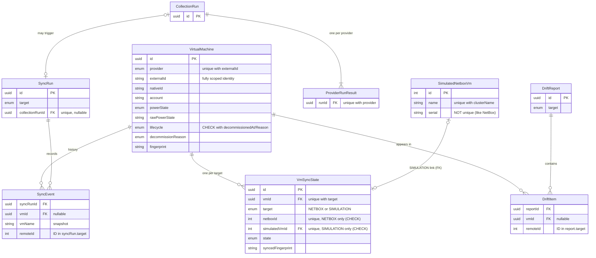

# CloudVM – Database Design

PostgreSQL 16 via Prisma 6. Source of truth: `backend/prisma/schema.prisma`
plus two CHECK constraints in `backend/prisma/sql/init_check_constraints.sql`.

## Entity-relationship diagram



## 1. Identity – `@@unique([provider, externalId])` with a fully scoped `externalId`

The provider's own ID is only guaranteed unique **inside some scope** (an account, a project,
a cluster, a vCenter). `externalId` therefore always contains that scope. It is built in exactly
one place, `src/domain/identity.ts`, which rejects empty or `/`-containing parts.

| Provider | `externalId` format | Example (from the MOCK data) | Why this scope |
|---|---|---|---|
| AWS | `<accountId>/<region>/<instanceId>` | `123456789012/ap-south-1/i-0a1b2c3d4e5f60001` | AWS does not document instance IDs as globally unique; account + region is the API's own boundary (DescribeInstances is per account, per region) |
| Azure | `<subscriptionId>/<vmId>` | `00000000-aaaa-4bbb-8ccc-000000000001/6f1c9a3e-0000-4000-8000-000000000001` | `vmId` is a GUID that survives renames and resource-group moves (the ARM resource ID does not); lower-cased because GUIDs are case-insensitive |
| GCP | `<projectId>/<instanceId>` | `cloudvm-demo-project/4417300000000000001` | numeric instance id is unique within a project; zone is not included because it is not part of the identity |
| Proxmox | `<clusterName>/<vmid>` | `pve-dc1/100` and `pve-lab/100` (two different VMs) | VMIDs restart at 100 in every cluster |
| VMware | `<vCenter host>/<instanceUuid>` | `vcsa01.corp.example.com/50000001-1a2b-4c3d-8e9f-0a1b2c3d4e5f` | instance UUID is unique per vCenter; morefs (`vm-1001`) are per-vCenter and change on re-registration |

Extra columns: `nativeId` (the bare provider ID, for display/search) and `account` (the top-level
scope, **required**, indexed with `provider`).

**Why one scoped string instead of `@@unique([provider, account, nativeId])`?**
1. AWS needs *two* scope parts (account and region); a single key handles every provider uniformly.
2. The same string is written to NetBox's built-in `serial` field (`aws:123456789012/ap-south-1/i-…`)
   so a NetBox record can be matched back exactly – no custom fields needed.
3. It avoids the PostgreSQL rule that **NULLs are never equal in a unique constraint**: a
   nullable scope column would silently allow duplicates.

**Known limitation (documented, not hidden):** Proxmox can re-use a VMID after a VM is deleted.
If that happens between two collections, the new VM inherits the old row. A LIVE Proxmox adapter
should append the VM's SMBIOS UUID (`smbios1` in the VM config) when available; the MOCK data does
not include it.

## 2. Lifecycle vs power state (AWS terminated)

Two separate questions, two separate columns:

- **`lifecycle`**: does the VM still exist? `ACTIVE` or `DECOMMISSIONED`.
- **`powerState`**: if it exists, is it on? `RUNNING`, `STOPPED`, `SUSPENDED` or `UNKNOWN`.
- **`rawPowerState`**: the provider's own word, always kept.

Mapping is done in one tested function, `src/domain/state.ts`:

| Provider value | lifecycle | powerState | decommissionReason |
|---|---|---|---|
| AWS `running` / `pending` | ACTIVE | RUNNING | – |
| AWS `stopping` / `stopped` | ACTIVE | STOPPED | – |
| AWS `shutting-down` / `terminated` | **DECOMMISSIONED** | **UNKNOWN** | `PROVIDER_TERMINATED` |
| GCP `TERMINATED` | ACTIVE | STOPPED (GCP's word for stopped) | – |
| Azure `PowerState/deallocated` | ACTIVE | STOPPED | – |
| Anything unrecognised (`REPAIRING`, `unknown`, missing) | ACTIVE | UNKNOWN | – |

A terminated instance therefore **cannot** be counted as a stopped VM. Its power state is `UNKNOWN`,
because a deleted VM has no power state, and every dashboard power count is filtered on
`lifecycle = ACTIVE`.

There are two ways a VM becomes decommissioned (`DecommissionReason`):

- **`PROVIDER_TERMINATED`**: the provider said so explicitly. Only AWS does this; terminated
  instances stay visible for about an hour.
- **`MISSING_FROM_PROVIDER`**: the VM was absent from a **successful** collection of its provider
  and account (M3). A failed collection never decommissions anything.

The database keeps the three fields consistent with CHECK constraint `virtual_machines_lifecycle_check`:

- `ACTIVE` ⇒ `decommissionedAt` and `decommissionReason` are NULL.
- `DECOMMISSIONED` ⇒ both are set.

Rows are never deleted, so this is a soft delete. In NetBox the VM is set to `decommissioning`.

## 3. Real NetBox vs simulation – `VmSyncState`

Sync state lives in its own table, with **one row per VM per target**
(`@@unique([vmId, target])`). Each target has its own ID column:

| target | ID column | Validated by |
|---|---|---|
| `NETBOX` | `netboxId` (`@unique`) | NetBox itself (M4 re-reads the record and checks `serial` before updating) |
| `SIMULATION` | `simulatedVmId` (`@unique`, **foreign key** → `simulated_netbox_vms.id`) | PostgreSQL FK: the simulated record must exist |

Four separate safety nets stop a simulated ID being used against live NetBox:

1. **Different columns.** The live gateway only ever reads `netboxId` from rows where
   `target = NETBOX`. It never sees `simulatedVmId`.
2. **CHECK constraint `vm_sync_states_target_id_check`.** A `NETBOX` row cannot hold a
   `simulatedVmId`, and a `SIMULATION` row cannot hold a `netboxId`. Tested in
   `schema.test.ts` and verified against PostgreSQL 16.
3. **Foreign key.** A simulated ID that doesn't exist is rejected (P2003). If a simulated
   record is deleted, the link becomes NULL.
4. **Separate fingerprints per target.** Switching `NETBOX_MODE` from simulation to live does
   *not* make VMs look "already synced". The live target has its own `PENDING` state, so
   everything is created in real NetBox.

`netboxId @unique` also prevents two local VMs from claiming the same NetBox record.
`SyncEvent.remoteId` and `DriftItem.remoteId` are history only. They are interpreted using
their run or report's `target` and are never read back to drive a write.

## 4. Relations, nullability, onDelete

| Relation | Nullable? | onDelete | Reason |
|---|---|---|---|
| `VmSyncState.vm` | no | **Cascade** | sync state is meaningless without its VM |
| `VmSyncState.simulatedVm` | yes | **SetNull** | resetting the simulation must not delete our sync history; the VM becomes PENDING again |
| `ProviderRunResult.run` | no | **Cascade** | a provider result belongs to exactly one run |
| `SyncRun.collectionRun` | yes (`@unique`) | **SetNull** | manual "sync only" runs have none; sync history survives deleting a collection run; at most one sync per collection |
| `SyncEvent.syncRun` | no | **Cascade** | events are part of their run |
| `SyncEvent.vm` | yes | **SetNull** | audit trail survives; `vmName` snapshot keeps it readable |
| `DriftItem.report` | no | **Cascade** | items are part of their report |
| `DriftItem.vm` | yes | **SetNull** | `ORPHAN_IN_NETBOX` items have no local VM; snapshot `name` kept |

**Nullable VM attributes** (`hostname`, `osName`, `cpuCores`, `memoryMb`, `diskGb`, `region`,
`cluster`, `owner`, `rawPowerState`) mean "the provider did not tell us". NULL is used instead of a
fake value such as `0` or `""`, so the UI can show "Unknown" honestly.

**Required** fields are identity (`provider`, `externalId`, `nativeId`, `account`), `name`,
`dataSource`, `rawData`, `fingerprint` and `lastDiscoveredAt`.

## 5. Unique constraints and indexes

| Table | Constraint / index | Purpose |
|---|---|---|
| virtual_machines | **unique (provider, externalId)** | no duplicate VM rows |
| | index (provider, account) | per-account decommission detection, provider filters |
| | index (lifecycle, powerState) | dashboard counts, inventory filters |
| | index (name), index (lastDiscoveredAt) | search, "last seen" sorting |
| vm_sync_states | **unique (vmId, target)** | one state per VM per target |
| | **unique (netboxId)**, **unique (simulatedVmId)** | one local VM per remote record |
| | index (target, state) | "what needs syncing / what failed" |
| provider_run_results | **unique (runId, provider)** | provider collected once per run |
| sync_runs | **unique (collectionRunId)**, index (target, startedAt) | one sync per collection; history lists |
| sync_events | index (syncRunId), index (vmId) | run detail, VM history |
| drift_reports / drift_items | index (target, generatedAt), index (reportId, type) | latest report, filter by type |
| simulated_netbox_vms | **unique (clusterName, name)**, index (serial) | mirrors NetBox's rule; lookup by serial |

## 6. Other decisions
- **Normalized columns + `rawData` JSON.** The common model is used for querying. The original
  payload is kept for audit ("why does CloudVM say 16 GB?").
- **Fixed binary units.** `memoryMb` holds **MiB** (1024 × 1024 bytes); the M1 column name is kept
  for compatibility. `diskGb` holds **GiB** (1024³ bytes). Providers and NetBox already count RAM
  in MiB even when they call it "MB" (Azure `memoryInMB` 4096 = 4 GiB), so AWS/Azure/GCP/VMware
  memory is stored as is and only byte values (Proxmox `maxmem`/`maxdisk`, VMware disk capacity)
  are divided by 1024² / 1024³. No decimal (×1.048576) conversion is ever applied. See
  `docs/NORMALIZATION.md`.
- **Change detection.** `VirtualMachine.fingerprint` vs `VmSyncState.syncedFingerprint` per
  target. If they are equal, the VM is skipped, which makes sync idempotent.
- **`SimulatedNetboxVm` mirrors NetBox** field names, units, status values and the
  name-per-cluster uniqueness rule. `serial` is not unique, so duplicate detection (M4) gets an
  honest test in simulation.
- **UUID primary keys** for our own entities. **Postgres enums** for closed sets, so invalid
  values are rejected by the database.

## Applying the init migration (CHECK constraints included)
```bash
cd backend
npx prisma migrate dev --name init --create-only                          # writes SQL, applies nothing
cat prisma/sql/init_check_constraints.sql >> prisma/migrations/*_init/migration.sql
npx prisma migrate dev                                                    # applies it
```
Prisma does not model CHECK constraints, so `prisma migrate diff` neither creates nor removes them.
`scripts/verify-m1.sh` checks that they exist.
