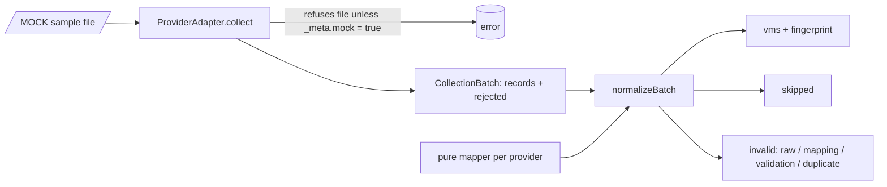

# CloudVM – Provider Adapters & Normalization (M2)

> All provider data in this prototype is **MOCK** (sample files in `backend/sample-data/`).
> No real AWS, Azure, GCP, Proxmox or VMware API is called.

## Pipeline

| Layer | File(s) | Responsibility |
|---|---|---|
| Interface | `src/modules/providers/ProviderAdapter.ts` | `collect(): Promise<CollectionBatch<TRaw>>`; `provider`, `dataSource` |
| MOCK adapters | `src/modules/providers/mock/*.mock-adapter.ts` | read the sample file, enforce the MOCK label, validate **each record** with the M1 Zod schemas, join lookups (instance types, volumes, NICs, guest agent) into one raw record per VM |
| Mappers | `src/modules/normalization/mappers/*.mapper.ts` | pure function: one raw record → `vm` / `skipped` / `invalid` |
| Engine | `src/modules/normalization/normalizer.ts` | runs the mapper, validates output against `NormalizedVm`, removes duplicate identities, fingerprints |
| Common model | `src/domain/normalized-vm.ts` | Zod schema = the final quality gate |
| Registry | `src/modules/providers/registry.ts` | `defineProvider(adapter, mapper)` – type-checked pairing; `createMockProviders()` |

**Why the adapter pattern:** collection, inventory and sync code depend only on `ProviderAdapter`.
A LIVE adapter (AWS SDK, Azure SDK, Proxmox API, vSphere API) returns the same raw record type,
so the mapper, engine and everything downstream stay unchanged.

**Why adapter and mapper are separate:** adapters do I/O; mappers are pure functions, so every
rule is tested with plain objects and no network or files.

## Record outcomes

| Outcome | When | Example |
|---|---|---|
| `vm` | mapped and passed the `NormalizedVm` schema | 58 of the 60 sample entries |
| `skipped` | valid record that is deliberately not a VM | Proxmox template, Proxmox LXC container |
| `invalid` / `raw` | record failed the provider's raw schema (adapter) | GCP `diskSizeGb: "lots"` |
| `invalid` / `mapping` | no stable identity (e.g. unparsable ARM ID / AZ) or mapper error | Azure id `/bogus/path` |
| `invalid` / `validation` | mapper output breaks `NormalizedVm` (bad IP, negative CPU, lifecycle rule) | – |
| `invalid` / `duplicate` | same `externalId` twice in one batch – first kept | a VMware VM listed twice |

One bad record never stops a batch. Only an unusable **source** throws (file missing, not labelled
MOCK, VMware file without its vCenter host).

## Units – binary convention (all providers)

| Field | Unit | AWS | Azure | GCP | Proxmox | VMware |
|---|---|---|---|---|---|---|
| `memoryMb` | **MiB** (1024² bytes) | `SizeInMiB` as is | `memoryInMB` as is (it is MiB) | `memoryMb` as is; custom type name decoded | `maxmem` bytes ÷ 1024² | `memory_size_MiB` as is |
| `diskGb` | **GiB** (1024³ bytes) | Σ EBS `Size` | OS disk + data disks `diskSizeGB` | Σ `diskSizeGb` (strings) | `maxdisk` bytes ÷ 1024³ | Σ disk `capacity` bytes ÷ 1024³ |

The column keeps the M1 name `memoryMb` for compatibility. Missing or nonsensical values become
`null` with a warning; values are never invented.

## Per-provider mapping

| | AWS | Azure | GCP | Proxmox | VMware |
|---|---|---|---|---|---|
| externalId | `<account>/<region>/<instanceId>` | `<subscription>/<vmId>` | `<project>/<instanceId>` | `<cluster>/<vmid>` | `<vCenter>/<instanceUuid>` |
| name | `Name` tag, else instance ID (warning) | resource name | instance name | name | VM name |
| hostname | `PrivateDnsName` | `osProfile.computerName` | `hostname` (only if custom) | guest agent | guest identity (VMware Tools) |
| IPs | private + public | NIC private IPs | internal + NAT | guest agent (link-local dropped) | guest identity |
| OS | `PlatformDetails` | osType + image | boot disk license | `ostype` code → name | guest full name, else `guest_OS` |
| CPU | instance type vCPUs | size cores | machine type / custom name | `maxcpu` | `cpu_count` |
| region / cluster | region / AZ | location / resource group | region / zone | – / cluster | – / vSphere cluster |
| owner | `Owner`/`owner`/`CreatedBy` tag | `owner`/`Owner` tag | `owner` label | `owner-<team>` tag | tag category `Owner` |
| power | `terminated`/`shutting-down` → **DECOMMISSIONED** | `PowerState/*`; none → UNKNOWN | `TERMINATED` → STOPPED | `unknown` → UNKNOWN | `POWERED_*`, `SUSPENDED` |

## Fingerprint
SHA-256 of a canonical JSON (fixed field order, sorted IPs, sorted tag keys) of the sync-relevant
fields. It excludes `discoveredAt`, `rawData`, `rawPowerState` and `dataSource`, so repeated
collections of unchanged data give identical fingerprints (verified: 58 distinct, identical on re-run).

## Scope decisions
- **Proxmox templates** are skipped (VM images, not VMs).
- **Proxmox LXC containers** are skipped. They are not virtual machines, and containers are out of
  scope for this prototype. **Possible future enhancement:** map LXC to NetBox virtual machines with a
  `proxmox-lxc` tag, as several Proxmox → NetBox integrations do.

## Expected result for the 60 MOCK entries
**58 VMs** (AWS 14, Azure 12, GCP 12, Proxmox 9, VMware 11), **2 skipped**, **0 invalid**.
Power states: 39 RUNNING, 13 STOPPED, 2 SUSPENDED, 4 UNKNOWN. One VM is DECOMMISSIONED (the AWS
terminated instance).
