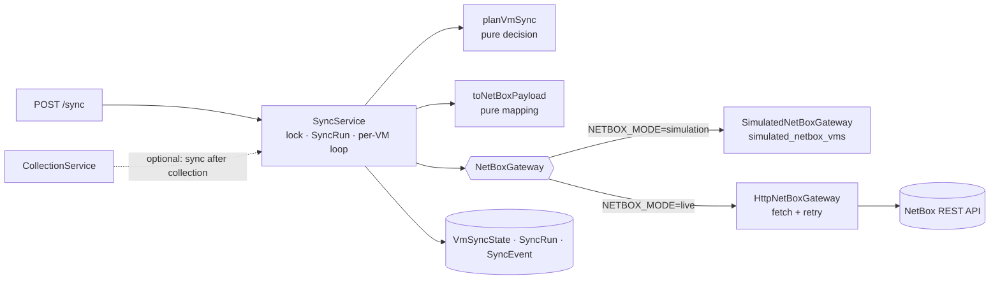

# CloudVM – M4 NetBox Synchronization Design

> Status: **APPROVED and implemented** (dry run and circuit breaker cut for the deadline) · NetBox stays in **SIMULATION** mode until the full workflow is verified.
> A simulated sync is always recorded as `target = SIMULATION` and is never reported as a real NetBox sync.

## 1. Architecture



| Component | File | Notes |
|---|---|---|
| `NetBoxGateway` interface | `src/modules/netbox/NetBoxGateway.ts` | `target`, `ensureCluster`, `getVm`, `findBySerial`, `findByName`, `createVm`, `updateVm` |
| `SimulatedNetBoxGateway` | `src/modules/netbox/simulated.gateway.ts` | Prisma on `simulated_netbox_vms`; enforces NetBox's rules (name unique per cluster, serial not unique) |
| `HttpNetBoxGateway` | `src/modules/netbox/http.gateway.ts` | Real REST client: `Token`/`Bearer` auth, timeouts, retries. **Built and contract-tested against a local fake HTTP server only – not enabled, not claimed as verified against real NetBox** |
| Mapping | `src/modules/netbox/mapping.ts` | `NormalizedVm row → NetBox payload`, diff of changed fields |
| Decision | `src/modules/sync/plan.ts` | Pure: SKIP / CREATE / UPDATE / DECOMMISSION / DUPLICATE |
| `SyncService` | `src/modules/sync/sync.service.ts` | Lock, SyncRun, loop, VmSyncState/SyncEvent writes |
| Routes | `src/modules/sync/sync.routes.ts` | `POST /sync`, `GET /sync/runs`, `GET /sync/runs/:id`, `GET /netbox/status`, `GET /netbox/simulated-vms` |

**No database schema change.** `VmSyncState`, `SyncRun`, `SyncEvent` and `SimulatedNetboxVm` from M1 cover everything.

## 2. NetBox endpoints used (documented REST API only, no custom fields)

| Purpose | Endpoint |
|---|---|
| Version / reachability | `GET /api/status/` |
| Cluster types | `GET/POST /api/virtualization/cluster-types/` |
| Clusters | `GET/POST /api/virtualization/clusters/` |
| Tags | `GET/POST /api/extras/tags/` |
| VMs | `GET /api/virtualization/virtual-machines/?serial=…` · `?name=…&cluster_id=…` · `GET/POST/PATCH …/virtual-machines/{id}/` |

No `DELETE` is ever issued. `serial` is a built-in VM field since NetBox 4.1. VM `disk` is in **MB** since 4.1.

## 3. Field mapping

| CloudVM | NetBox VM field | Rule |
|---|---|---|
| `name` | `name` | Unique per cluster in NetBox. If another VM with a **different serial** holds the name, use `name (<8-char nativeId>)`, e.g. the two VMware `app-server` VMs |
| `provider:externalId` | `serial` | `netboxSerial()`, e.g. `aws:123456789012/ap-south-1/i-0a1b…` – the matching key |
| provider + `cluster` (or region, or account) | `cluster` | One NetBox cluster per `PROVIDER/<cluster>` (e.g. `VMWARE/Prod-Cluster-01`, `PROXMOX/pve-dc1`, `AWS/ap-south-1a`); cluster type `CloudVM <Provider>`; both created on demand |
| `cpuCores` | `vcpus` | as is |
| `memoryMb` (MiB) | `memory` | as is (NetBox "MB" = MiB in practice) |
| `diskGb` (GiB) | `disk` | × 1024 → MB |
| lifecycle / power | `status` | DECOMMISSIONED → `decommissioning`; RUNNING → `active`; STOPPED → `offline`; SUSPENDED → `offline`; UNKNOWN → **not sent** (create uses NetBox's default, update leaves it unchanged) |
| tags | `tags` | Only `cloudvm-managed` and `cloudvm-mock` (the data is MOCK). Provider tags are not pushed |
| hostname, IPs, OS, owner, region, data source | `comments` | Read-only text block, e.g. `CloudVM (MOCK data) · owner: web-team · os: … · ips: …` |
| – | `description` | `Managed by CloudVM – MOCK provider data` |

**Not synced (out of scope):** IP address objects and interfaces, platform, tenant/contacts.

## 4. Sync lifecycle

```
POST /sync ─► acquire lock ─► SyncRun(RUNNING, target) ─► ensure tags + clusters
          └─► for each VirtualMachine (ACTIVE and DECOMMISSIONED):
                 state = VmSyncState[vm, target]
                 decision = planVmSync(vm, state)
                 SKIP          fingerprint == syncedFingerprint and SYNCED          (no API call)
                 SKIP          DECOMMISSIONED and never synced                       (don't create dead VMs)
                 resolve remote record:
                    1. state.remoteId  -> GET; must still exist AND have our serial
                    2. findBySerial    -> 0 / 1 / many
                    3. findByName in cluster (adopt only if serial is empty)
                 many matches  -> DUPLICATE   (no write; state DUPLICATE; event)
                 none          -> CREATE      (POST)                 [ACTIVE only]
                 one           -> UPDATE      (PATCH changed fields only; DECOMMISSION if lifecycle says so)
                 success -> state SYNCED, remoteId, syncedFingerprint = vm.fingerprint, lastSyncedAt
                 failure -> state FAILED, lastError (retried on the next sync)
          └─► SyncRun(SUCCESS | PARTIAL | FAILED, counts) ─► release lock
```

- **Idempotent:** the second sync of unchanged data makes **zero** gateway calls and zero writes (all SKIP).
- **Change-driven:** an updated VM is PATCHed with only the changed fields; the diff is stored in `SyncEvent.diff`.
- **Decommission:** a DECOMMISSIONED VM is PATCHed to `status=decommissioning`; the NetBox record is never deleted. A reactivated VM goes back to `active`.
- **Events:** one `SyncEvent` per CREATE / UPDATE / DECOMMISSION / DUPLICATE / failure; SKIPs are counted only (no 58 noise rows per run).
- **Trigger:** manual `POST /sync` (`{ dryRun?: boolean }`). Running sync automatically after a collection is wired in M6 (scheduler) behind a flag.
- **Locking:** same pattern as collection (in-process lock + RUNNING-row guard per target).
- **Dry run:** read-only gateway calls; the plan is recorded as events on a `dryRun` SyncRun; no VM, state or simulated record is written.

## 5. Error handling

| Error | Example | Handling |
|---|---|---|
| Validation (400) | bad field value | that VM FAILED with NetBox's message; continue |
| Name conflict (400 unique / Prisma P2002 in simulation) | name taken in cluster | retry once with the disambiguated name, else FAILED |
| Not found (404) on stored remoteId | record deleted in NetBox | forget the id, re-match by serial, CREATE if absent |
| Auth (401/403) | bad token | **abort the run** (FAILED); no further calls; states untouched |
| Rate limit (429) | – | retry, honour `Retry-After` |
| Server/network (5xx, timeout, ECONNRESET) | – | retry with backoff; then VM FAILED |
| Repeated transport failures | NetBox down | circuit breaker: after 5 consecutive transport failures abort the run (FAILED/PARTIAL), remaining VMs untouched |

The simulation gateway raises the **same error classes** (e.g. a P2002 becomes a `NameConflictError`), so the engine's code path is identical in both modes and the simulation tests exercise the real logic.

## 6. Retry strategy (HTTP gateway)

- **Retried:** GET and PATCH (idempotent), plus 429 / 5xx / network errors / timeouts.
- **Not retried:** 400, 401, 403, 404, 409.
- **3 attempts**, exponential backoff with jitter (≈ 250 ms → 1 s → 2 s), `Retry-After` respected (max 10 s), **10 s timeout** per request (AbortController).
- **POST create is never blindly retried:** after a transport failure, the gateway first looks the VM up by `serial` (read-your-write). If the first POST actually succeeded, the record is adopted instead of creating a duplicate.
- Requests are sequential (58 VMs is small, and it is gentle on NetBox).

## 7. Simulation vs live safety
- `SyncRun.target`, `VmSyncState.target` and every API response carry `SIMULATION`; `/health` and `/netbox/status` say "no real NetBox contacted".
- IDs are kept apart by M1's `VmSyncState` (FK + CHECK). Switching to live starts from PENDING; no simulated ID or fingerprint is reused.
- Live mode refuses to start sync if `GET /api/status/` fails, and is not enabled in this milestone.

## 8. Test plan

**Unit (no DB):**
- mapping: status, disk ×1024, serial, cluster naming, comments, MOCK tags, UNKNOWN not sent, diff
- `planVmSync`: all branches
- retry helper: backoff, `Retry-After`, non-retryable codes
- error classification
- `HttpNetBoxGateway` against a local fake HTTP server: auth header (Token/Bearer), `?serial=` lookup, create, PATCH, 404 / 400 / 401 / 429 / 500, timeout, create-then-verify after a network error

**Integration (test DB, simulation):**
- first sync: 57 CREATE + 1 SKIP (terminated, never synced); both `app-server` VMs created (one disambiguated)
- second sync: 58 SKIP and **0 gateway calls** (spy)
- inventory change → 1 UPDATE with diff
- collection removes a VM → DECOMMISSION (`decommissioning`), record kept; reactivation → `active`
- duplicate serials in NetBox → DUPLICATE, no write
- stale remoteId → re-matched / re-created
- one VM failing → PARTIAL, only it retried next time
- auth failure → run FAILED, states untouched
- concurrent sync → one 409
- dry run writes nothing
- target is always SIMULATION
- M0–M3 suites unchanged

**API:** `POST /sync` 202/409, `GET /sync/runs`, run detail with events, `/netbox/simulated-vms`, dashboard `lastSync`.

**`scripts/verify-m4.sh`:** M3 checks + sync tests + live demo (collect → sync → sync again = 58 skipped → change → sync = 1 update).
